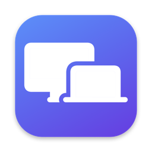

<p align="center"></p>

<h1 align="center">DisplayToggle</h1>

<p align="center">
一个免费的 macOS 菜单栏小工具：不用拔线，就能<b>断开 / 重新连接</b>任意显示器，并切换分辨率。
</p>

<p align="center"><a href="README.md">English</a> · <b>简体中文</b></p>

---

## 功能

- **断开 / 重新连接任意显示器**：在菜单栏点一下即可。断开后 macOS 会把它当作拔掉了线——窗口自动移到其他屏幕，显卡也不再驱动它。外接显示器和 MacBook 自带屏幕都支持。
- **分辨率与刷新率**：列出全部模式，标注 HiDPI 和系统默认分辨率。
- **亮度和音量滑块**直接放在菜单里。外接显示器通过 DDC/CI 调节（需 Apple 芯片，且显示器支持 DDC），自带屏幕使用系统接口。音量跟随当前输出设备；如果声音走 HDMI/DisplayPort，则通过 DDC 调节显示器自身的音量。
- **重置**：已断开的显示器旁有 ↻ 按钮，用来重新检测——线还插着就重新连接；已经拔掉就先从菜单中移除，以后再插上时会自动重新出现。
- **重置连接**（⌘R）：对所有显示器执行重置——重新连接所有被断开的显示器，并移除已经拔线的显示器记录，不改动分辨率。
- **安全保护**：不允许断开最后一个显示器；如果所有屏幕都黑了（比如关了自带屏后又拔掉外接线），会自动全部重新连接。
- **仅本次登录有效**：注销或重启后所有显示器都会回来，不会被黑屏锁死。
- **登录时启动**开关（使用 macOS 原生登录项）。对勾始终反映系统的真实状态；如果需要你在系统设置中授权，菜单会注明，并通过系统通知引导你去设置。
- **中文 / English** 界面，默认跟随系统，也可在菜单里切换。
- **命令行**，方便写脚本、配合快捷指令或快捷键。

## 系统要求

macOS 13 Ventura 及以上，Apple Silicon 和 Intel 均可。

## 安装

**下载**：在 [Releases](../../releases) 下载 `DisplayToggle-x.y.z.zip`，解压后把 `DisplayToggle.app` 拖到「应用程序」。
App 使用 ad-hoc 签名、未经公证，首次打开请右键 →「打开」，或运行：

```bash
xattr -dr com.apple.quarantine /Applications/DisplayToggle.app
```

**从源码构建**（需要 Xcode Command Line Tools）：

```bash
git clone https://github.com/yhshu/DisplayToggle.git
cd DisplayToggle
make install
```

## 命令行

```bash
CLI=/Applications/DisplayToggle.app/Contents/MacOS/DisplayToggle

$CLI list                          # 列出显示器及其状态和当前模式
$CLI off Sceptre                   # 断开（可用序号、显示器 ID 或名称的一部分）
$CLI on 2                          # 重新连接
$CLI toggle "LG"                   # 切换连接状态
$CLI reset LG                      # 重置单个显示器：插着就重连，拔了就移除
$CLI reset                         # 对所有显示器执行重置
$CLI modes Sceptre                 # 列出全部分辨率 / 刷新率
$CLI res Sceptre 2560x1440 hidpi 60
$CLI brightness LG 60               # 亮度 0–100（不带数值则读取当前值）
$CLI volume 30                     # 当前输出设备的音量
$CLI login on|off                  # 登录时启动
```

提示：把 `$CLI toggle <名称>` 放进「快捷指令」的「运行 Shell 脚本」操作里，即可绑定快捷键。

## 原理

断开功能调用 CoreGraphics 私有函数 `CGSConfigureDisplayEnabled`（以 `kCGConfigureForSession` 生效）；改分辨率使用公开的 `CGConfigureDisplayWithDisplayMode`。由于依赖私有接口，未来的 macOS 更新可能使其失效。

## 卸载

在菜单中关闭「登录时启动」，退出 App，删除 `/Applications/DisplayToggle.app`（或运行 `make uninstall`）。

## 许可证

[PolyForm Noncommercial 1.0.0](LICENSE.md)：免费用于个人、教育、研究等非商业用途，**禁止商业使用**。

Copyright © 2026 Yiheng Shu
